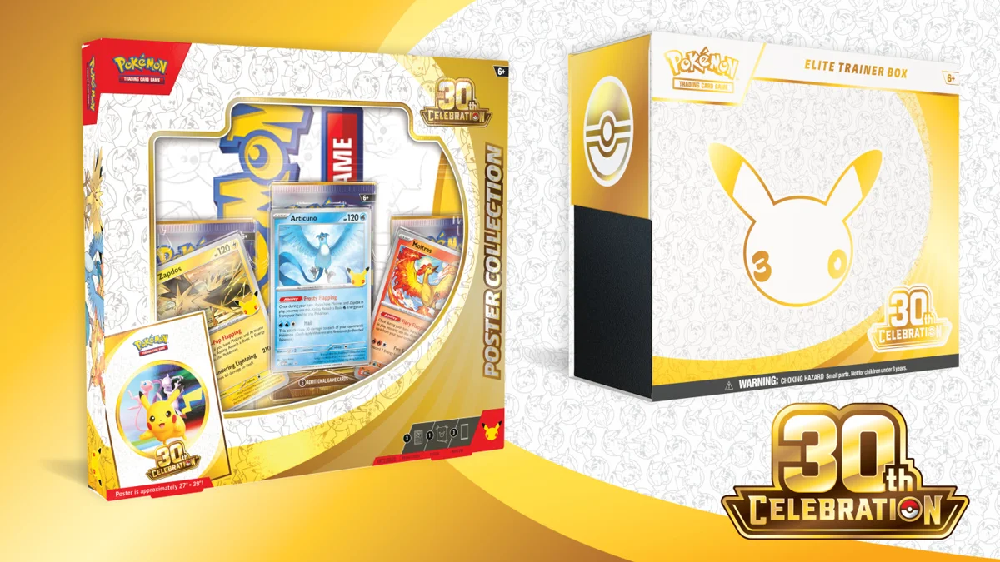
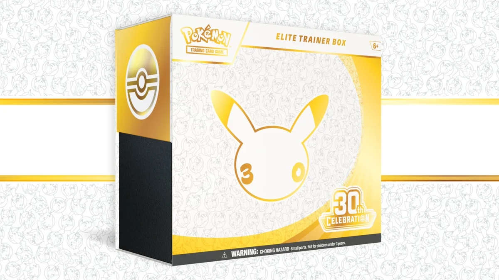
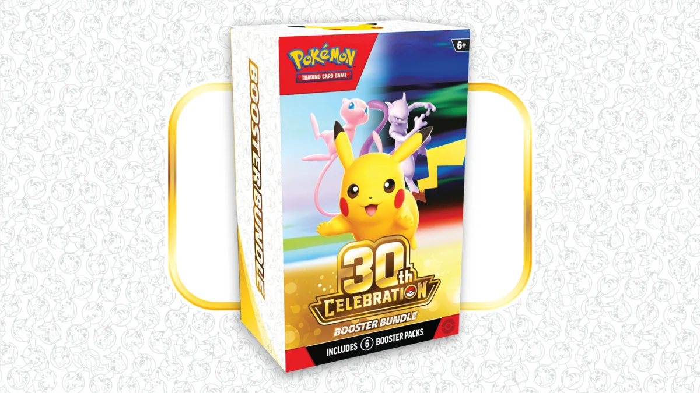
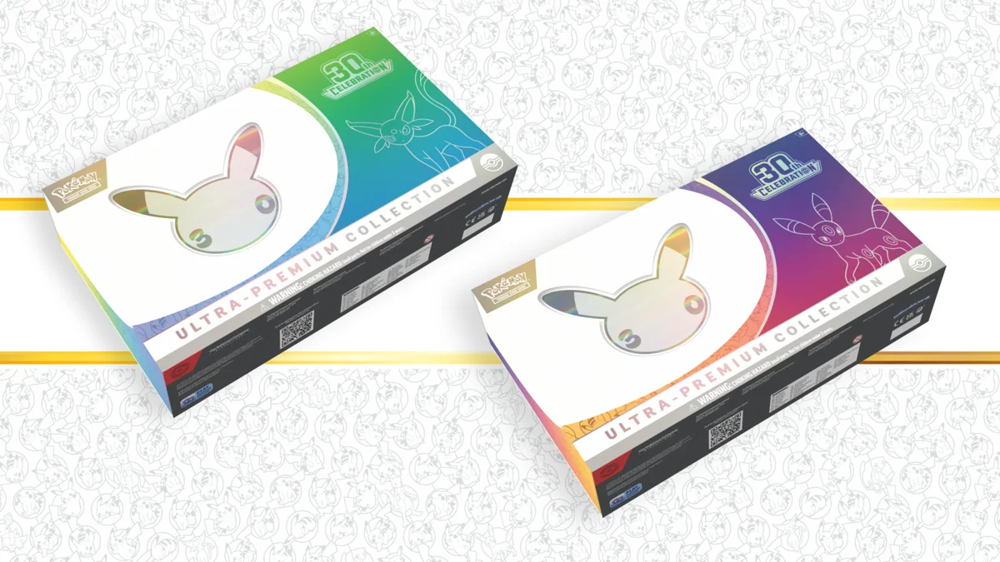

Sortie le 16 septembre 2026, **30ᵉ Anniversaire** (*30th Celebration* en anglais) est l'extension du JCC Pokémon qui fête les 30 ans du jeu, lancée le même jour dans le monde entier. Toutes les cartes des boosters sont brillantes, une nouvelle rareté apparaît, et chaque booster contient l'un des 30 Pikachu rares.

**Mise à jour du 13 novembre 2026** : contenu de l'ETB, de l'UPC et des coffrets, dates de sortie en France (les dernières tombent le 27 novembre) et [où trouver les produits](#ou-trouver).

<figure class="illustration">
  
  <figcaption class="illustration__caption">© The Pokémon Company International</figcaption>
</figure>

## Ne pas confondre : le Coffret Journée Pokémon n'est PAS le set 30 ans

Il existe **deux produits distincts** portant tous les deux le thème "30 ans" :

| | **Coffret Journée Pokémon 30 ans 2026** | **Extension 30ᵉ Anniversaire** |
|---|---|---|
| Sortie | Début 2026 | 16 septembre 2026 |
| Contenu | 3 boosters d'extensions variées + promo Pikachu + pièce | Boosters 30ᵉ Anniversaire |
| Lien avec le set | Aucun | C'est le set lui-même |

**Le Coffret Journée Pokémon** est un produit promotionnel indépendant, sorti en début d'année dans le cadre des 30 ans de la franchise. Il ne contient **aucun booster 30ᵉ Anniversaire**.

---

## En bref : le set 30 ans en un tableau

| Élément | Détail |
|---|---|
| Sortie | **16 septembre 2026**, simultanée dans le monde entier |
| Série | Méga-Évolution |
| Cartes brillantes | Toutes les cartes des boosters, Énergie de base comprise |
| Nouvelle rareté | « futuriste rare » (*Futuristic rare* en anglais) |
| Taille du set | **Plus de 150 cartes** |
| Cartes par booster | **5 cartes brillantes + 1 énergie de base brillante** (dont 1 Pikachu rare parmi 30) |
| Booster Collection Classique | 3 cartes — dans la Collection Ultra-Premium |

Sources : [annonce de sortie](https://www.pokemon.com/fr/actualites/lextension-30-anniversaire-du-jcc-pokemon-est-disponible) et [présentation des produits](https://www.pokemon.com/fr/actualites/jcc-pokemon-produits-30-anniversaire) sur pokemon.com.

---

## Ce qui rend ce set unique

<figure class="illustration" style="text-align:center">
  
  <figcaption class="illustration__caption">© The Pokémon Company International</figcaption>
</figure>

### Des boosters 100 % brillants, Énergie incluse

Chaque carte d'un booster 30ᵉ Anniversaire est brillante, y compris la carte Énergie de base, illustrée par YOSHIROTTEN ([page officielle de l'extension](https://tcg.pokemon.com/fr-fr/expansions/30th-celebration/)).

En contrepartie, le booster est **réduit** : 6 cartes (5 brillantes + 1 énergie) au lieu de la dizaine d'un booster classique. À garder en tête pour juger le rapport prix/carte.

### 30 Pikachu, 30 styles d'illustration

Chaque booster contient une carte rare Pikachu parmi 30, chacune dans un style d'illustration différent. La page officielle ne nomme pas les artistes.

<figure class="illustration">
  <svg viewBox="0 0 600 200" xmlns="http://www.w3.org/2000/svg" role="img" aria-label="Schéma : chaque booster 30th Celebration contient 5 cartes brillantes, dont 1 Pikachu rare parmi 30 illustrations, plus 1 énergie de base brillante, et parfois une carte futuriste rare.">
    <defs>
      <linearGradient id="cel-bg" x1="0" y1="0" x2="0" y2="1">
        <stop offset="0%"  stop-color="#1c2030"/>
        <stop offset="100%" stop-color="#0d1018"/>
      </linearGradient>
    </defs>
    <rect x="0" y="0" width="600" height="200" fill="url(#cel-bg)"/>
    <text x="300" y="24" font-family="JetBrains Mono, monospace" font-size="10" fill="#9b9789" letter-spacing="2" text-anchor="middle">CONTENU GARANTI PAR BOOSTER</text>

    <g transform="translate(20,44)">
      <rect x="0" y="0" width="170" height="130" rx="6" fill="#1c2030" stroke="#7ed4c9" stroke-width="1.5"/>
      <text x="85" y="40" font-family="Plus Jakarta Sans, sans-serif" font-size="34" fill="#7ed4c9" font-weight="700" text-anchor="middle">5</text>
      <text x="85" y="64" font-family="JetBrains Mono, monospace" font-size="9" fill="#f2eee2" letter-spacing="1.2" text-anchor="middle">CARTES BRILLANTES</text>
      <text x="85" y="84" font-family="Plus Jakarta Sans, sans-serif" font-size="9" fill="#9b9789" text-anchor="middle">+ 1 énergie de base</text>
      <text x="85" y="100" font-family="Plus Jakarta Sans, sans-serif" font-size="9" fill="#9b9789" text-anchor="middle">brillante (6 en tout)</text>
    </g>

    <g transform="translate(210,44)">
      <rect x="0" y="0" width="170" height="130" rx="6" fill="#1c2030" stroke="#f7c948" stroke-width="1.5"/>
      <text x="85" y="18" font-family="JetBrains Mono, monospace" font-size="8" fill="#9b9789" letter-spacing="2" text-anchor="middle">DONT</text>
      <text x="85" y="48" font-family="Plus Jakarta Sans, sans-serif" font-size="28" fill="#f7c948" font-weight="700" text-anchor="middle">×1</text>
      <text x="85" y="70" font-family="JetBrains Mono, monospace" font-size="9" fill="#f2eee2" letter-spacing="1.2" text-anchor="middle">PIKACHU RARE</text>
      <text x="85" y="90" font-family="Plus Jakarta Sans, sans-serif" font-size="9" fill="#9b9789" text-anchor="middle">parmi 30 illustrations</text>
      <text x="85" y="106" font-family="Plus Jakarta Sans, sans-serif" font-size="9" fill="#9b9789" text-anchor="middle">30 styles différents</text>
    </g>

    <g transform="translate(400,44)">
      <rect x="0" y="0" width="170" height="130" rx="6" fill="#1c2030" stroke="#d97246" stroke-width="2"/>
      <text x="85" y="18" font-family="JetBrains Mono, monospace" font-size="8" fill="#9b9789" letter-spacing="2" text-anchor="middle">PARFOIS</text>
      <text x="85" y="46" font-family="Plus Jakarta Sans, sans-serif" font-size="15" fill="#d97246" font-weight="700" text-anchor="middle">FUTURISTE RARE</text>
      <text x="85" y="68" font-family="JetBrains Mono, monospace" font-size="9" fill="#f2eee2" letter-spacing="1.2" text-anchor="middle">NOUVELLE RARETÉ</text>
      <text x="85" y="88" font-family="Plus Jakarta Sans, sans-serif" font-size="9" fill="#9b9789" text-anchor="middle">possible, pas garantie</text>
      <text x="85" y="104" font-family="Plus Jakarta Sans, sans-serif" font-size="9" fill="#9b9789" text-anchor="middle">Mewtwo / Mew</text>
    </g>
  </svg>
  <figcaption class="illustration__caption">
    <strong>Un booster = 5 cartes brillantes + 1 énergie de base brillante</strong> · le Pikachu rare fait partie des 5 cartes brillantes, il ne s'ajoute pas · taux d'apparition de la futuriste rare non communiqué
  </figcaption>
</figure>

### La « futuriste rare » : nouvelle rareté signée YOSHIROTTEN

La **futuriste rare** (*Futuristic rare* en anglais) est la nouvelle rareté de l'extension. Ses cartes sont imaginées par l'artiste **YOSHIROTTEN**, et la page officielle montre **Mewtwo** et **Mew** dans ce traitement. Aucun taux d'apparition n'est publié.

Pour comprendre la hiérarchie des raretés du JCC Pokémon, voir notre guide des raretés.

---

## Le calendrier des sorties en France

Les produits ne sont pas tous sortis le même jour. pokemon.com les répartit sur [septembre](https://www.pokemon.com/fr/actualites/decouvrez-tous-les-produits-du-jcc-pokemon-qui-sortiront-en-septembre-2026), [octobre](https://www.pokemon.com/fr/actualites/decouvrez-tous-les-produits-du-jcc-pokemon-qui-sortiront-en-octobre-2026) et [novembre](https://www.pokemon.com/fr/actualites/decouvrez-tous-les-produits-du-jcc-pokemon-qui-sortiront-en-novembre-2026) 2026, sans préciser le jour. Les dates au jour près ci-dessous viennent du [calendrier des sorties de Pokécardex](https://www.pokecardex.com/forums/viewtopic.php?t=49894), mis à jour le 7 novembre.

Au 13 novembre, il reste une échéance : le **27 novembre**, avec la Collection Ultra-Premium Journée et la Collection avec figurine Mewtwo.

<figure class="illustration">
  <svg viewBox="0 0 600 320" xmlns="http://www.w3.org/2000/svg" role="img" aria-label="Frise des sorties en France du set Pokémon 30 ans : 16 septembre, octobre (2 et 23), 6 novembre, puis 13 et 27 novembre 2026.">
    <defs>
      <linearGradient id="wave-bg" x1="0" y1="0" x2="0" y2="1">
        <stop offset="0%"  stop-color="#1c2030"/>
        <stop offset="100%" stop-color="#0d1018"/>
      </linearGradient>
    </defs>
    <rect x="0" y="0" width="600" height="320" fill="url(#wave-bg)"/>
    <text x="300" y="26" font-family="JetBrains Mono, monospace" font-size="10" fill="#9b9789" letter-spacing="2" text-anchor="middle">CALENDRIER DES SORTIES · SET 30 ANS</text>

    <!-- Ligne verticale -->
    <line x1="90" y1="44" x2="90" y2="300" stroke="#3a3f52" stroke-width="1.5"/>

    <!-- V1 -->
    <circle cx="90" cy="66" r="7" fill="#f7c948"/>
    <text x="110" y="62" font-family="JetBrains Mono, monospace" font-size="9" fill="#f7c948" letter-spacing="1">16 SEPT 2026</text>
    <text x="110" y="78" font-family="Plus Jakarta Sans, sans-serif" font-size="10" fill="#f2eee2">Coffret Dresseur d'élite, coffrets Amphinobi-ex / Nymphali-ex, Collection poster, blister</text>

    <!-- V2 -->
    <circle cx="90" cy="128" r="7" fill="#7ed4c9"/>
    <text x="110" y="124" font-family="JetBrains Mono, monospace" font-size="9" fill="#7ed4c9" letter-spacing="1">OCTOBRE 2026</text>
    <text x="110" y="140" font-family="Plus Jakarta Sans, sans-serif" font-size="10" fill="#f2eee2">Lot de boosters et Mini-boîtes (2 oct.), Collection classeur (23 oct.)</text>

    <!-- V3 -->
    <circle cx="90" cy="192" r="7" fill="#9c8454"/>
    <text x="110" y="188" font-family="JetBrains Mono, monospace" font-size="9" fill="#9c8454" letter-spacing="1">6 NOV 2026</text>
    <text x="110" y="204" font-family="Plus Jakarta Sans, sans-serif" font-size="10" fill="#f2eee2">Decks Combat, Ultra-Premium Soirée, Premium Métamorph, figurine Mew</text>

    <!-- V4 -->
    <circle cx="90" cy="256" r="7" fill="#d97246"/>
    <text x="110" y="252" font-family="JetBrains Mono, monospace" font-size="9" fill="#d97246" letter-spacing="1">13 ET 27 NOV 2026</text>
    <text x="110" y="268" font-family="Plus Jakarta Sans, sans-serif" font-size="10" fill="#f2eee2">Collection autocollant (13), Ultra-Premium Journée et figurine Mewtwo (27)</text>
  </svg>
  <figcaption class="illustration__caption">
    <strong>Dates de sortie en France</strong> · jours d'après le calendrier Pokécardex, mois confirmés par pokemon.com
  </figcaption>
</figure>

### Septembre 2026

| Produit | Contenu clé | Sortie |
|---|---|---|
| **Coffret Dresseur d'élite (ETB)** | 9 boosters + promo Nidorina entièrement illustrée + 65 protège-cartes + 16 énergies brillantes + dés | 16 sept. |
| **Coffret Amphinobi-ex / Nymphali-ex** | 4 boosters + promo + carte grand format | 16 sept. |
| **Collection poster** | 3 boosters + 3 promos Artikodin / Électhor / Sulfura + poster | 16 sept. |
| **Blister de 2 boosters** | 2 boosters + Évoli brillant + pièce | 16 sept. |
| **Collection K.O.** | 2 boosters + Évoli brillant + pièce | 24 sept. |

Le **Coffret Dresseur d'élite** est le produit central du lancement. Il contient 9 boosters.

<figure class="illustration">
  
  <figcaption class="illustration__caption">© The Pokémon Company International</figcaption>
</figure>

### Octobre 2026

| Produit | Contenu clé | Sortie |
|---|---|---|
| **Lot de boosters** (bundle) | 6 boosters | 2 oct. |
| **Mini-boîtes** | 2 boosters + autocollants + carte artistique ; 10 illustrations qui s'assemblent en deux images, jour et nuit | 2 oct. |
| **Collection classeur** | Classeur à 9 pochettes + 5 boosters | 23 oct. |

<figure class="illustration">
  
  <figcaption class="illustration__caption">© The Pokémon Company International</figcaption>
</figure>

### Novembre 2026

| Produit | Contenu clé | Sortie |
|---|---|---|
| **Decks Combat Mentali-ex / Noctali-ex** | 60 cartes brillantes + promo Victini ou Zeraora + étui, pièce, tapis | 6 nov.* |
| **Collection Ultra-Premium Soirée (UPC)** — Pikachu-ex + Noctali-ex | 29 boosters + 1 booster Collection Classique de 3 cartes + accessoires | 6 nov. |
| **Collection Premium Métamorph** | 8 boosters + promo Métamorph + porte-carte acrylique | 6 nov. |
| **Collection avec figurine Mew** | 5 boosters + promo + carte grand format + figurine | 6 nov. |
| **Collection autocollant réajustable** (tripack, Noadkoko d'Alola ou Lucario) | 3 boosters + promo + autocollants | 13 nov. |
| **Collection Ultra-Premium Journée (UPC)** — Pikachu-ex + Mentali-ex | 29 boosters + 1 booster Collection Classique de 3 cartes + accessoires | 27 nov. |
| **Collection avec figurine Mewtwo** | 5 boosters + promo + carte grand format + figurine | 27 nov. |

\* pokemon.com classe les Decks Combat dans les sorties d'octobre ; Pokécardex les date du 6 novembre.

La **Collection Ultra-Premium** est le plus gros produit de la gamme : 30 boosters en tout, booster Collection Classique compris.

<figure class="illustration">
  
  <figcaption class="illustration__caption">© The Pokémon Company International</figcaption>
</figure>

### La Collection Classique

La Collection Ultra-Premium contient un **booster Collection Classique** de 3 cartes : des réimpressions de cartes emblématiques des 30 dernières années. La [page officielle de l'extension](https://tcg.pokemon.com/fr-fr/expansions/30th-celebration/) cite le **Dracaufeu du Set de Base** et **Pikachu et Zekrom-GX** (Soleil et Lune – Duo de Choc).

---

## Où trouver les produits 30 ans {#ou-trouver}

pokemon.com indique seulement que la gamme se trouve « dans les points de vente habituels des produits du JCC Pokémon », sans citer d'enseigne ni de limite d'achat. En pratique :

- **Grandes enseignes culturelles et boutiques spécialisées** : c'est le circuit habituel pour l'ETB, le Lot de boosters, les coffrets et l'UPC. Les modalités de vente (quantité par client, réservation) se décident enseigne par enseigne : seule la fiche produit de l'enseigne fait foi.
- **Bureaux de tabac et presse** : la Collection K.O. leur est réservée, d'après le calendrier Pokécardex.

### UPC : limite d'achat

Les deux Collections Ultra-Premium sortent à trois semaines d'écart : Soirée le 6 novembre, Journée le 27 novembre. Sur les fiches Philibert consultées le 13/11/2026 ([Soirée](https://www.philibertnet.com/fr/pokemon/184748-pokemon-30-ans-coffret-ultra-premium-noctali-descelle-196214155398.html), [Journée](https://www.philibertnet.com/fr/pokemon/184752-pokemon-30-ans-coffret-ultra-premium-mentali-descelle-2100001434595.html)), l'achat est limité à **1 exemplaire par foyer** et la boîte est vendue « descellée » : le film plastique est incisé pour décourager la revente, le contenu restant inchangé.

### Prix conseillés

pokemon.com ne publie aucun prix. Le calendrier Pokécardex indique **55,99 €** pour l'ETB, **35,99 €** pour le Lot de boosters et **229,99 €** pour chaque UPC.

[**Voir l'ETB 30ᵉ Anniversaire sur Amazon** (lien affilié)](https://www.amazon.fr/s?k=pokemon+30th+celebration+ETB&tag=rareradar-21&ascsubtag=rr-set30-produits)

[**Voir le scellé 30ᵉ Anniversaire sur eBay** (lien affilié)](https://www.ebay.fr/sch/i.html?_nkw=pokemon+30th+celebration&campid=5339154295&customid=rr-set30-produits)

**Accessoires de protection** : sur des cartes toutes brillantes, la moindre rayure se voit. Le combo *penny sleeve + outer sleeve rigide* s'impose dès l'ouverture.

[**Penny sleeves + protections cartes** sur Amazon (lien affilié)](https://www.amazon.fr/s?k=penny+sleeves+standard+pokemon+100&tag=rareradar-21&ascsubtag=rr-set30-sleeves) · ou consultez notre guide double-sleeving Pokémon TCG pour le détail de la méthode.

---

## FAQ

**Q : Quand est sorti le set Pokémon 30 ans ?**

R : Le 16 septembre 2026, simultanément dans le monde entier. Les produits de la gamme s'échelonnent ensuite jusqu'au 27 novembre 2026.

**Q : Où trouver l'ETB et l'UPC 30 ans ?**

R : Dans les points de vente habituels du JCC Pokémon : grandes enseignes culturelles et boutiques spécialisées. L'ETB est sorti le 16 septembre, l'UPC Soirée le 6 novembre, l'UPC Journée sort le 27 novembre. Détail dans la section [Où trouver les produits 30 ans](#ou-trouver).

**Q : Est-ce que toutes les cartes sont vraiment brillantes ?**

R : Oui pour les boosters : la page officielle indique que toutes les cartes des boosters 30ᵉ Anniversaire sont brillantes, carte Énergie de base comprise.

**Q : C'est quoi la futuriste rare ?**

R : La nouvelle rareté introduite avec ce set (*Futuristic rare* en anglais). Ses cartes sont imaginées par l'artiste YOSHIROTTEN ; la page officielle montre Mewtwo et Mew.

**Q : Le Coffret Journée Pokémon 30 ans, c'est le même set ?**

R : Non. Le Coffret Journée Pokémon 30 ans est un produit promotionnel indépendant sorti début 2026, qui contient des boosters d'extensions variées et une promo Pikachu. Il n'a aucun lien avec l'extension 30ᵉ Anniversaire de septembre.

**Q : Combien de cartes y a-t-il dans le set ?**

R : Plus de 150, d'après pokemon.com, qui ne donne pas de total exact.

**Q : Y a-t-il une display ?**

R : Aucune display ne figure dans la gamme présentée par pokemon.com ni au calendrier Pokécardex. Les boosters passent par le Lot de boosters (6), l'ETB (9), les coffrets et l'UPC.

---

## Ce que les sources ne précisent pas (au 13 novembre 2026)

- Les prix conseillés officiels : pokemon.com n'en affiche pas
- Le taux d'apparition de la futuriste rare
- Les noms des artistes des 30 Pikachu
- Le nombre de cartes de la Collection Classique

---

## À lire aussi

- [Chaos Ascendant (mai 2026) : le bilan de l'ère Méga]() — pour remettre le set 30th Celebration dans le contexte éditorial de l'année
- [Ouvrir, garder scellé ou grader : que faire de vos 30th Celebration ?](/2026/pokemon-30-ans-ouvrir-garder-scelle-grader/) — le calcul revente, ouverture et grading

---

---

## Sources

- [JCC Pokémon : produits 30ᵉ Anniversaire (pokemon.com)](https://www.pokemon.com/fr/actualites/jcc-pokemon-produits-30-anniversaire)
- [L'extension 30ᵉ Anniversaire est disponible (pokemon.com)](https://www.pokemon.com/fr/actualites/lextension-30-anniversaire-du-jcc-pokemon-est-disponible)
- Sorties du mois sur pokemon.com : [septembre](https://www.pokemon.com/fr/actualites/decouvrez-tous-les-produits-du-jcc-pokemon-qui-sortiront-en-septembre-2026), [octobre](https://www.pokemon.com/fr/actualites/decouvrez-tous-les-produits-du-jcc-pokemon-qui-sortiront-en-octobre-2026), [novembre](https://www.pokemon.com/fr/actualites/decouvrez-tous-les-produits-du-jcc-pokemon-qui-sortiront-en-novembre-2026) 2026
- [Page de l'extension 30ᵉ Anniversaire (tcg.pokemon.com)](https://tcg.pokemon.com/fr-fr/expansions/30th-celebration/)
- [Calendrier des sorties JCC Pokémon 2026 (Pokécardex)](https://www.pokecardex.com/forums/viewtopic.php?t=49894)
- Fiches Philibert : [UPC Soirée](https://www.philibertnet.com/fr/pokemon/184748-pokemon-30-ans-coffret-ultra-premium-noctali-descelle-196214155398.html), [UPC Journée](https://www.philibertnet.com/fr/pokemon/184752-pokemon-30-ans-coffret-ultra-premium-mentali-descelle-2100001434595.html)
